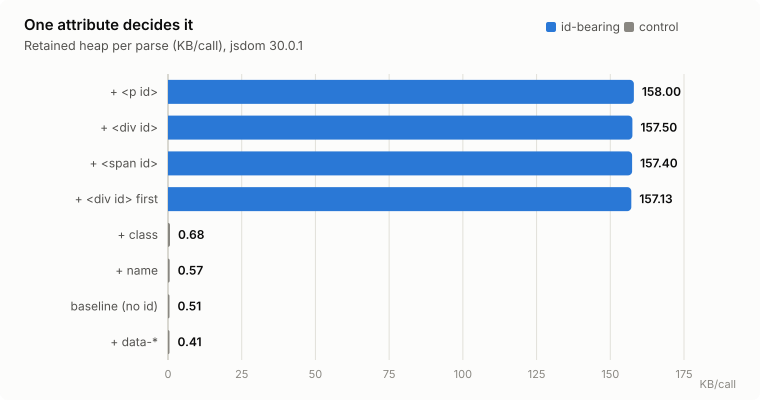
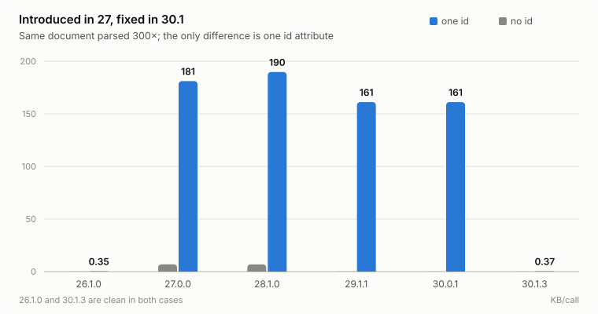
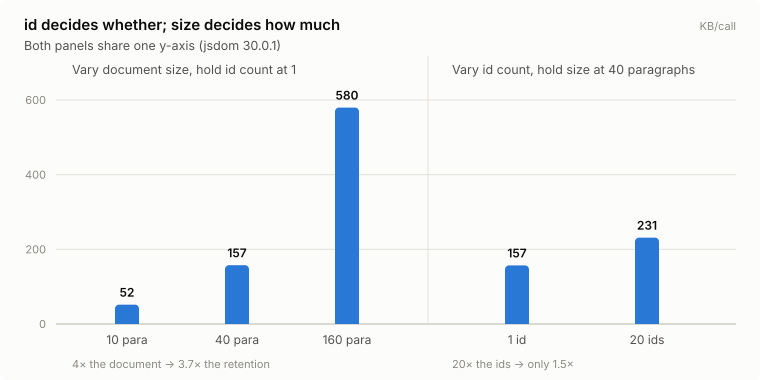
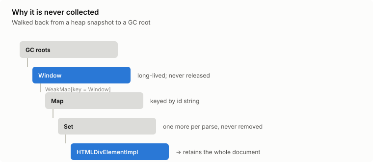

**English** · [繁體中文](README.zh-TW.md)

# jsdom `id` attribute retention — a memory leak report

> **In jsdom ≥ 27, parsing a document that contains a single element with an `id`
> attribute — from a long-lived `Window` — permanently retains the entire
> document.** Present from 27.0.0 through 30.0.1; **fixed in 30.1.0**
> (2026-09-17). If you are on 27–30.0.x, upgrade.

The story of how this was found in production — the crash loop, the wrong
guesses, and how the cause was narrowed down — is written up (in Traditional
Chinese) at [https://alexyu-blog.com/blog/20261025-jsdom-id-attribute-memory-leak](https://alexyu-blog.com/blog/20261025-jsdom-id-attribute-memory-leak).

Every number below was produced by the scripts in this repository; the raw
output of that run is committed under [`results/`](results/) — macOS,
Node v24.13.0, Docker 29.5.2, 2026-08-12. The matrix was re-run on 2026-10-20
against the then-latest 30.1.3 to check whether upstream had fixed it; it had.

Whether it happens is gated by the `id` attribute alone. Element type and
position are irrelevant; document size only determines *how much* is retained.
`class`, `data-*` and `name` on an `<a>` do not trigger it at all. (The upstream
report notes that `name` on elements such as ``, `<form>` or `<iframe>`
does, for the same reason — see [Upstream status](#upstream-status).)

---

## Why this matters

The pattern "one long-lived `Window`, many short-lived `Document`s" is exactly
what an HTML sanitizer does on a server. Creating a `Window` is expensive, so
every server-side wrapper creates one at module load and parses every incoming
payload against it:

```js
import createDOMPurify from 'dompurify'
import { JSDOM } from 'jsdom'

// one Window for the lifetime of the process
const purify = createDOMPurify(new JSDOM('').window)

export const sanitize = (html) => purify.sanitize(html)
```

Real-world CMS HTML is full of `id` attributes — ad slots, anchors,
table-of-contents targets. Under this pattern each request can retain its whole
document, megabytes at a time, for the lifetime of the process.

Minimal reproductions posted publicly tend to use markup like `<p>Hello</p>`,
which has **no `id`** — and therefore show a leak roughly two orders of
magnitude smaller than the real-world one. That sampling gap is, as far as I can
tell, why this has been filed as a performance regression rather than a leak.

---

## The minimal proof

No sanitizer involved — plain jsdom. Same document parsed 300 times from one
`Window`; the only difference between the two rows is a single `id` attribute.

```js
// 01-minimal.mjs
import { JSDOM } from 'jsdom'
import { retainedPerCall, row, body } from './lib/measure.mjs'

const parseRepeatedly = (html) => {
  const { window } = new JSDOM('')          // one Window, reused — like a server would
  const parser = new window.DOMParser()
  return () => parser.parseFromString(html, 'text/html')
}

row('no id attribute',   await retainedPerCall(parseRepeatedly(`<body>${body()}</body>`)))
row('one <div id="ad1">', await retainedPerCall(parseRepeatedly(`<body>${body()}<div id="ad1"></div></body>`)))
```

`body()` is 40 paragraphs of Lorem ipsum and deliberately contains no `id`. The
`<div id="ad1">` that gets appended is empty — whatever it retains is not its
own content.

---

## Results

Retained heap per call in KB, after forced GC. Full tables for every version are
in [RESULTS.md](RESULTS.md); the raw log is in [`results/`](results/). The figures
below are generated from that same run by [`charts/build.mjs`](charts/build.mjs) —
open [`charts/index.html`](charts/index.html) for all four with table views.







**The version boundary** (`01-minimal.mjs`, plain jsdom, no sanitizer):

| jsdom | no id | one `id` | |
|---|---:|---:|---|
| 26.1.0 | 0.11 | 0.35 | clean |
| 27.0.0 | 6.90 | **181.09** | retention starts |
| 28.1.0 | 6.88 | **189.73** | |
| 29.1.1 | 0.11 | **161.14** | baseline fixed, retention not |
| 30.0.1 | 0.11 | **161.14** | last affected release |
| 30.1.0 | -0.15 | 0.33 | **fixed** |
| 30.1.3 | 0.10 | 0.37 | clean |

The 30.1.x rows come from the 2026-10-20 run; 30.1.0 was checked with
`01-minimal.mjs` only, to find the release that fixed it. Every row from 26.1.0
to 30.0.1 reproduced within noise of the numbers above on that run.

**It is `id`, not "one more element"** (`02-attribute-ablation.mjs`, jsdom 30.0.1):

| | retained |
|---|---:|
| baseline, no id | 0.51 KB/call |
| `+ <div id>` | **157.50** |
| `+ <p id>` | **158.00** |
| `+ <span id>` | **157.40** |
| `+ <div id>` first rather than last | **157.13** |
| control: `+ class` | 0.68 |
| control: `+ data-*` | 0.41 |
| control: `+ name` | 0.57 |

Element type does not matter, position does not matter, and the other three
attributes sit at baseline. On the same element, a `class` costs 0.68 KB/call
and an `id` costs 157.50 — a factor of 230 between two attributes.

**One `id` pins the whole document** (`03-scaling.mjs`, jsdom 30.0.1):

| | retained |
|---|---:|
| 10 paragraphs + 1 id | 51.83 KB/call |
| 40 paragraphs + 1 id | 157.47 |
| 160 paragraphs + 1 id | **579.68** |
| 40 paragraphs + **20** ids | 231.31 |

Retention tracks document size, not id count. A single `id` is a switch, not a
dial.

On a production CMS article — 41,316 bytes of HTML with the usual ad slots and anchor
targets — the same measurement gives **~2.7 MB retained per parse**. That
document is not in this repository; the synthetic fixtures reproduce the
mechanism and the scaling law without it.

---

## Retainer chain

`04-heap-snapshot.mjs` parses an id-bearing document 120 times and writes a V8
heap snapshot; `retainers.py` walks the largest surviving `HTMLDivElementImpl`
back to a GC root, skipping weak edges:

```bash
node --expose-gc 04-heap-snapshot.mjs
python3 retainers.py out/leak.heapsnapshot HTMLDivElementImpl
```

Actual output, abridged — the full walk is in
[`results/retainer-chain.txt`](results/retainer-chain.txt):

```
═══ retainer chain of HTMLDivElementImpl [object] sz=328 ═══
  (GC roots) [synthetic]
    --element:19-->
  (Stack roots) [synthetic]
    --internal:33-->
  Window [object] sz=24
    --internal:5 / part of key (Window @7235) -> value (Map @311695) pair in WeakMap (table @310159)-->
  Map [object] sz=32
    --internal:table-->
   [array] sz=152
    --internal:6-->
  Set [object] sz=32
    --internal:table-->
   [array] sz=2600            ← grows with every parse
    --internal:83-->
  HTMLDivElementImpl [object] sz=328
```

In shape:



```
GC roots
  └─ Window                              (long-lived; never released)
       └─ WeakMap[key = Window] → Map    (keyed by id string)
            └─ Set                       (elements carrying that id)
                 └─ HTMLDivElementImpl → ...the entire document
```

The `Set`'s backing array grows linearly with the number of parses. Nothing ever
removes entries from it. And because a retained element keeps its `parentNode` alive,
retaining one element retains the whole tree it belongs to.

This is the shape of an `id → element` lookup cache scoped to the **`Window`**
rather than to the **`Document`**. Every `Document` parsed from that `Window`
adds its id-bearing elements to the shared cache, and they are never evicted.

> When this was written, the mechanism was inferred from the retainer shape plus
> the fact that `id` is the sole trigger — not from reading jsdom's internals.
> Upstream has since confirmed it: the cache is the tracker behind **named
> access on `window`** (`window.<id>`), in `lib/jsdom/living/window-properties.js`.
> It registered id-bearing elements from *every* document sharing the `Window`,
> including ones from `DOMParser`, and only removed them when they were detached
> — which never happens to a document that is simply discarded.

---

## Upstream status

**Fixed in jsdom 30.1.0** (released 2026-09-17), by
[jsdom#4236](https://github.com/jsdom/jsdom/pull/4236), "Scope named window
properties to the associated document" (merged 2026-08-18), which closes
[jsdom#4234](https://github.com/jsdom/jsdom/issues/4234). That issue was filed
independently on 2026-08-12, the same day as the run in this repository, and
describes the same retainer chain. The [30.1.0 release notes](https://github.com/jsdom/jsdom/releases/tag/v30.1.0)
do list it, as one of 67 bullets: "Fixed elements in documents created with
`DOMParser` or `document.implementation.createHTMLDocument()` appearing as named
properties on `window` and being retained in memory." It does not say "leak" or
"`id`", so a changelog skim is unlikely to connect it to this; running the
reproduction against the new version will.

Before that, the mechanism was visible in public trackers under several
different names. None of them is "memory leak in jsdom":

| Report | Framing | Status |
|---|---|---|
| [isomorphic-dompurify#368](https://github.com/kkomelin/isomorphic-dompurify/issues/368) | unbounded heap growth in long-running processes | closed — via an opt-in [`clearWindow()`](https://github.com/kkomelin/isomorphic-dompurify/releases/tag/3.0.0) added in 3.0.0 |
| [DOMPurify#1089](https://github.com/cure53/DOMPurify/issues/1089) | leak with DOMPurify + jsdom, suspected `NodeIterator` | closed |
| [jsdom#3985](https://github.com/jsdom/jsdom/issues/3985), [jsdom#3936](https://github.com/jsdom/jsdom/issues/3936) | "performance regression in v27" | open |

Until 30.1.0, the only fix that shipped was the downstream `clearWindow()`
workaround: if you never call it, you still leak. As of 2026-10-20 the two jsdom
issues are still open, though the retention they partly describe is gone.

Note the 29.1.1 row in the version table — the *no-id* baseline improves sharply
while the `id` case barely moves. jsdom 29.0.0's release notes contain:

> Improved `Document` initialization performance by lazily initializing the CSS
> selector engine, avoiding ~0.5 ms of overhead per `Document`.

The versions line up with the baseline improvement. I have not verified that
this specific change is what moved the baseline, only that the boundary matches.

---

## Fix, and a workaround if you cannot upgrade

**Upgrade to jsdom ≥ 30.1.0.** Then run `01-minimal.mjs` against the version you
actually deploy; that is the only reliable way to know.

If you are stuck on 27–30.0.x, the cache is scoped to the `Window`, so the only
exit is to stop the `Window` from living forever:

```js
import createDOMPurify from 'dompurify'
import { JSDOM } from 'jsdom'

let purify, window
let count = 0

const renew = () => {
  window?.close()
  window = new JSDOM('').window
  purify = createDOMPurify(window)   // addHook / setConfig must be re-applied here
  count = 0
}

renew()

export const sanitize = (html) => {
  if (count++ > 500) renew()         // the old Window and its id cache are collected together
  return purify.sanitize(html)
}
```

Pick the threshold from your average document size, not from a round number.
At the ~2.7 MB/parse observed on a 41 KB real-world article, 500 parses is
already more than 1 GB of retention before the reset.

Pinning `jsdom@26.1.0` also avoids it, at the cost of every fix and feature
that landed in 27 and later. Now that 30.1.0 exists, there is little reason to
stay there.

---

## Measurement discipline

Two mistakes here produce numbers that look convincing and are wrong. Both are
handled in [`lib/measure.mjs`](lib/measure.mjs):

1. **Force GC, and require `--expose-gc`.** Without it you measure garbage that
   has not been collected yet, not memory that *cannot* be collected.
2. **Yield to the event loop inside the loop.** jsdom defers part of its cleanup
   to finalizers, which never run inside a fully synchronous tight loop. A
   synchronous benchmark reports a large leak that does not exist in a real
   async server.

A third one is not about the harness but about inference: an ablation showing
"removing X makes the leak disappear" does **not** establish that X is the
cause — whatever you removed may have carried something else along with it.
Removing every `<div>` from a real document made the leak vanish here; wrapping
content in a `<div>` leaks nothing. The divs happened to be the elements
carrying `id`s. Only a minimal reproduction settles causality.

---

## Running it

### What you need

**Node 20+** is enough for every script (24.13.0 was used here). **Docker** is
only needed for `run-all.sh`, and **Python 3** only for `retainers.py`.

### Start here — one command, about a second

```bash
npm install
node --expose-gc 01-minimal.mjs
```

On the pinned jsdom 28.1.0 that prints something close to:

```
jsdom 28.1.0

no id attribute                         6.88 KB/call
one <div id="ad1">                    189.73 KB/call
```

Two rows, one `id` attribute between them. If you only run one thing, run this.

The last digits move a little between runs — this is a measurement, not a
constant. A local run here gave 6.86 and 189.79 against the 6.88 and 189.73 in
[`results/`](results/), which came from the container.

`--expose-gc` is not optional — the harness throws without it, because a
measurement taken without a forced GC reports uncollected garbage rather than
memory that cannot be collected.

### Then, in order

Each script answers one question, and each builds on the one before it:

| Step | The question it answers | Runtime |
|---|---|---|
| `node --expose-gc 01-minimal.mjs` | Does a single `id` attribute change anything? | ~1 s |
| `node --expose-gc 02-attribute-ablation.mjs` | Is it `id`, or just one more element? | ~4 s |
| `node --expose-gc 03-scaling.mjs` | Does retention track id count, or document size? | ~3 s |
| `node --expose-gc 04-heap-snapshot.mjs` | — writes `out/leak.heapsnapshot` (~53 MB, gitignored) | ~1 s |
| `python3 retainers.py out/leak.heapsnapshot HTMLDivElementImpl` | Why is it never collected? | ~1 s |

Scripts 02 and 03 go through DOMPurify, because that is the shape the problem
shows up in on a real server; 01 uses plain jsdom to prove no sanitizer is
involved. The npm scripts (`npm run minimal`, `ablation`, `scaling`, `snapshot`)
are the same commands with `--expose-gc` already set.

### The version matrix — where the other versions come from

`package.json` pins **one** jsdom version, and one package name cannot hold five
at once. The matrix does not come from `package.json`; each version is installed
over the pinned one:

```dockerfile
ARG JSDOM_VERSION=28.1.0
COPY package.json ./
RUN npm install … && npm install jsdom@${JSDOM_VERSION}   # ← overrides the pin
```

`run-all.sh` builds one image per version and runs every script inside it:

```bash
./run-all.sh                             # 26.1.0 / 27.0.0 / 28.1.0 / 29.1.1 / 30.0.1 / 30.1.3
./run-local.sh                           # same matrix, no Docker
JSDOM_VERSIONS="30.0.1" ./run-all.sh     # one version
SCRIPTS="01-minimal.mjs" ./run-all.sh    # one script
```

Both write to `results/raw-<timestamp>.txt`.

**You do not have to take the version labels on trust.** Every script prints the
version it actually loaded, read from the installed package at runtime:

```js
export const jsdomVersion = async () =>
  (await import('jsdom/package.json', { with: { type: 'json' } })).default.version
```

So the log labels itself: a block reading `jsdom 27.0.0` came from a process with
27.0.0 in `node_modules`. Faking it would mean actually installing that version.

**Docker or local?** `run-all.sh` gives each case a 4 GB container and a 2 GB
heap — enough headroom that the leak shows as a slope instead of crashing the
process mid-measurement, and it is what produced [`results/`](results/).
`run-local.sh` installs each version into `./node_modules` in turn and restores
the pin afterwards (it never rewrites `package.json`); it needs no Docker, but
runs on your host Node with no memory cap, so expect small drift.

**Near-zero readings are noise, and can come out negative.** A clean version may
report something like `-0.53 KB/call`. Anything under about 1 KB/call means
"nothing retained" and the sign carries no meaning down there. The signal is the
`id` column towering over the no-id column from 27.0.0 through 30.0.1 — that gap
is three orders of magnitude, far outside the noise.

### Regenerating the figures

```bash
node charts/build.mjs
```

Only necessary if you change the numbers in `build.mjs`; the committed SVGs
already match the committed runs (2026-08-12, plus 30.1.3 from 2026-10-20 in the
version-boundary chart).

## Files

| file | purpose |
|---|---|
| `01-minimal.mjs` | core proof, ~20 lines, no sanitizer involved |
| `02-attribute-ablation.mjs` | `id` vs `class` / `data-*` / `name`; element type; position |
| `03-scaling.mjs` | document size vs id count |
| `04-heap-snapshot.mjs` | writes `out/leak.heapsnapshot` |
| `retainers.py` | walks a snapshot back to a GC root |
| `lib/measure.mjs` | shared harness (forced GC, event-loop yields, warmup) |
| `Dockerfile`, `run-all.sh` | version matrix, in Docker |
| `run-local.sh` | the same matrix without Docker |
| `charts/build.mjs` | regenerates the figures from the committed run |
| `charts/index.html` | all four figures with table views, EN/ZH |

## License

MIT
