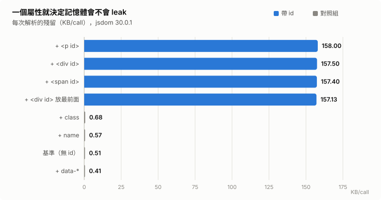
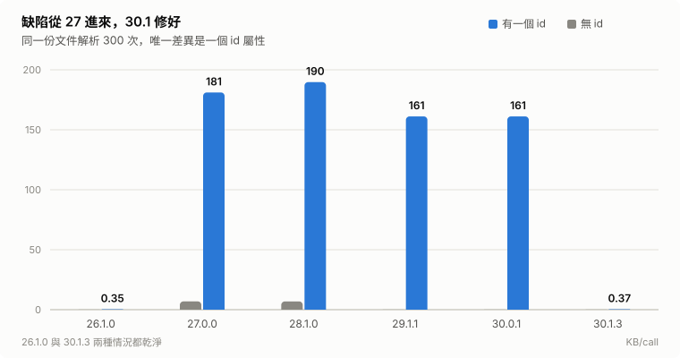
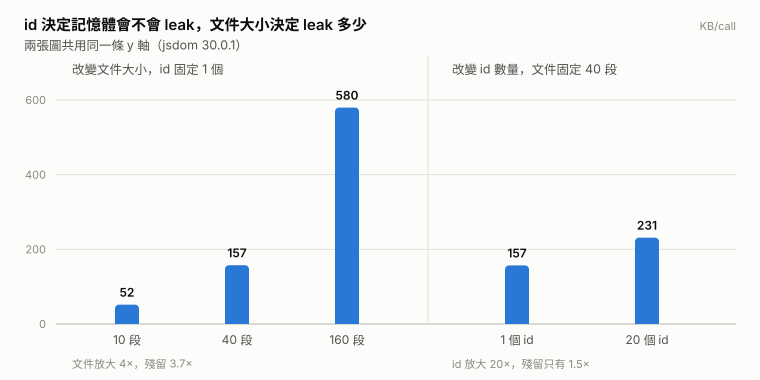

[English](README.md) · **繁體中文**

# jsdom `id` 屬性造成整份文件殘留——記憶體洩漏報告

> **在 jsdom ≥ 27，從一個常駐的 `Window` 解析出來的文件，只要裡面含有任何一個帶 `id` 屬性的元素，整份文件就會被永久保留。** 27.0.0 到 30.0.1 都有；**30.1.0（2026-09-17）已修好**。還在用 27～30.0.x 的話，請升級。

以下每一個數字都由本 repo 的腳本實跑產生，該次執行的原始輸出 commit 在 [`results/`](results/)——macOS、Node v24.13.0、Docker 29.5.2、2026-08-12。2026-10-20 對當時最新的 30.1.3 重跑了一次矩陣，確認上游有沒有修——修好了。

會不會發生，只由 `id` 屬性決定。元素種類與位置都無關；文件大小只決定**漏多少**。`class`、`data-*`，以及 `<a>` 上的 `name`，完全不會觸發。（上游的回報指出，``、`<form>`、`<iframe>` 這類元素上的 `name` 會，原因相同——見[上游狀態](#上游狀態)。）

---

## 為什麼這件事重要

「一個常駐的 `Window`，加上許多用完就丟的 `Document`」正是 server 端 HTML sanitizer 的標準形狀。建立 `Window` 的成本很高，所以每個 server 端的 wrapper 都會在模組載入時建一次，之後每一筆進來的內容都拿它來解析：

```js
import createDOMPurify from 'dompurify'
import { JSDOM } from 'jsdom'

// 一個 Window，用到行程結束
const purify = createDOMPurify(new JSDOM('').window)

export const sanitize = (html) => purify.sanitize(html)
```

真實世界的 CMS 內容裡到處都是 `id`——廣告版位、錨點、目錄跳轉。在這個形狀下，每一個 request 都可能永久留下它自己那份完整文件，一次幾 MB，直到行程死掉。

公開張貼的最小重現通常長得像 `<p>Hello</p>` 這種，**裡面沒有 `id`**，所以量出來的洩漏比真實世界的小了大約兩個數量級。就我看到的證據，這個取樣落差正是它一直被歸類成效能回歸、而不是記憶體缺陷的原因。

---

## 最小重現

不需要任何 sanitizer，純 jsdom 就能重現。同一份文件從同一個 `Window` 解析 300 次，兩列唯一的差別是一個 `id` 屬性：

```js
// 01-minimal.mjs
import { JSDOM } from 'jsdom'
import { retainedPerCall, row, body } from './lib/measure.mjs'

const parseRepeatedly = (html) => {
  const { window } = new JSDOM('')          // 一個 Window，重複使用，跟 server 上一樣
  const parser = new window.DOMParser()
  return () => parser.parseFromString(html, 'text/html')
}

row('no id attribute',   await retainedPerCall(parseRepeatedly(`<body>${body()}</body>`)))
row('one <div id="ad1">', await retainedPerCall(parseRepeatedly(`<body>${body()}<div id="ad1"></div></body>`)))
```

`body()` 是 40 段 Lorem ipsum，刻意不含任何 `id`。附加上去的 `<div id="ad1">` 是空的——它留下來的東西不是它自己的內容。

---

## 結果

每次呼叫的殘留堆積（KB），量測前後都強制 GC。每個版本的完整表格在 [RESULTS.zh-TW.md](RESULTS.zh-TW.md)，原始 log 在 [`results/`](results/)。下面的圖表由 [`charts/build.mjs`](charts/build.mjs) 從同一次執行產生，四張圖加表格檢視在 [`charts/index.html`](charts/index.html)。







**版本邊界**（`01-minimal.mjs`，純 jsdom、無 sanitizer）：

| jsdom | 無 id | 有一個 `id` | |
|---|---:|---:|---|
| 26.1.0 | 0.11 | 0.35 | 乾淨 |
| 27.0.0 | 6.90 | **181.09** | 缺陷從這版開始有 |
| 28.1.0 | 6.88 | **189.73** | |
| 29.1.1 | 0.11 | **161.14** | 基準被修好了，缺陷還在 |
| 30.0.1 | 0.11 | **161.14** | 最後一個有問題的版本 |
| 30.1.0 | -0.15 | 0.33 | **修好了** |
| 30.1.3 | 0.10 | 0.37 | 乾淨 |

30.1.x 兩列來自 2026-10-20 那次執行；30.1.0 只跑了 `01-minimal.mjs`，目的是找出哪一版修好的。那次執行裡，26.1.0 到 30.0.1 每一列都重現了上面的數字（差距在噪音範圍內）。

**是 `id`，不是「多了一個元素」**（`02-attribute-ablation.mjs`，jsdom 30.0.1）：

| | 殘留 |
|---|---:|
| 基準（無 id） | 0.51 KB/call |
| `+ <div id>` | **157.50** |
| `+ <p id>` | **158.00** |
| `+ <span id>` | **157.40** |
| `+ <div id>` 放最前面而非最後面 | **157.13** |
| 對照：`+ class` | 0.68 |
| 對照：`+ data-*` | 0.41 |
| 對照：`+ name` | 0.57 |

元素種類無關、位置無關，另外三個屬性都停在基準線。同一個元素上，掛 `class` 是 0.68、掛 `id` 是 157.50，差 230 倍。

**一個 `id` 釘住的是整份文件**（`03-scaling.mjs`，jsdom 30.0.1）：

| | 殘留 |
|---|---:|
| 10 段 + 1 個 id | 51.83 KB/call |
| 40 段 + 1 個 id | 157.47 |
| 160 段 + 1 個 id | **579.68** |
| 40 段 + **20** 個 id | 231.31 |

殘留跟著文件大小走，不跟著 id 數量走。一個 `id` 是開關，不是刻度。

換成一份正式站的 CMS 文章——41,316 bytes 的 HTML，帶著常見的廣告版位與錨點——同樣的量測給出 **每次解析約 2.7 MB**。那份文件不在這個 repo 裡；合成的 fixture 已經足以重現整個機制與 scaling law。

---

## 保留路徑

`04-heap-snapshot.mjs` 會把一份含 `id` 的文件解析 120 次並寫出 V8 heap snapshot；`retainers.py` 再把存活下來最大的那個 `HTMLDivElementImpl` 反向走訪回 GC root，過程中跳過 weak edge：

```bash
node --expose-gc 04-heap-snapshot.mjs
python3 retainers.py out/leak.heapsnapshot HTMLDivElementImpl
```

實際輸出（節錄，完整的走訪在 [`results/retainer-chain.txt`](results/retainer-chain.txt)）：

```
═══ retainer chain of HTMLDivElementImpl [object] sz=328 ═══
  (GC roots) [synthetic]
    --element:19-->
  (Stack roots) [synthetic]
    --internal:33-->
  Window [object] sz=24
    --internal:5 / part of key (Window @7235) -> value (Map @311695) pair in WeakMap (table @310159)-->
  Map [object] sz=32
    --internal:table-->
   [array] sz=152
    --internal:6-->
  Set [object] sz=32
    --internal:table-->
   [array] sz=2600            ← 每解析一次就長一點
    --internal:83-->
  HTMLDivElementImpl [object] sz=328
```

畫成形狀：


```
GC roots
  └─ Window                              （常駐，行程活著就不會釋放）
       └─ WeakMap[key = Window] → Map    （key 是 id 字串）
            └─ Set                       （具該 id 的元素集合）
                 └─ HTMLDivElementImpl → …整份文件
```

那個 `Set` 的底層陣列隨解析次數線性成長，沒有任何移除路徑。而一個元素被留住，它的 `parentNode` 就跟著活著，於是整棵樹都留下來。

這是一個 `id → element` 查詢快取的形狀，而它掛在 **`Window`** 層級，不是 **`Document`**層級。從那個 `Window` 解析出來的每一份 `Document`，都把自己帶 `id` 的元素塞進這個共用快取，而且永遠不會被移除。

> 寫這份報告時，機制是從保留路徑的形狀、加上「`id` 是唯一觸發條件」推出來的，不是讀 jsdom 內部實作得到的。後來上游確認了：這個快取就是 **`window` 具名存取**（`window.<id>`）背後的追蹤器，在 `lib/jsdom/living/window-properties.js`。它把共用同一個 `Window` 的**所有**文件（包括 `DOMParser` 產生的）裡帶 `id` 的元素都登記進去，只有在元素被移除時才清掉——而一份直接丟掉的文件，永遠不會觸發移除。

---

## 上游狀態

**jsdom 30.1.0（2026-09-17 發佈）已修好**，修正是 [jsdom#4236](https://github.com/jsdom/jsdom/pull/4236)「Scope named window properties to the associated document」（2026-08-18 合併），關掉了 [jsdom#4234](https://github.com/jsdom/jsdom/issues/4234)。那張 issue 是別人在 2026-08-12 獨立回報的，跟本 repo 實跑同一天，描述的是同一條保留路徑。[30.1.0 的 release note](https://github.com/jsdom/jsdom/releases/tag/v30.1.0) 有寫，是 67 條裡的一條：「Fixed elements in documents created with `DOMParser` or `document.implementation.createHTMLDocument()` appearing as named properties on `window` and being retained in memory.」但它沒有用「leak」也沒有提到 `id`，只掃 changelog 很難聯想到是這件事；對新版跑一次重現就看得出來。

在那之前，這個機制在公開的 tracker 上看得到，只是換了幾種名字。沒有一個叫做「jsdom 的記憶體洩漏」：

| 回報 | 被歸類成什麼 | 狀態 |
|---|---|---|
| [isomorphic-dompurify#368](https://github.com/kkomelin/isomorphic-dompurify/issues/368) | 長時間執行的程序記憶體無上限成長 | 已關閉——靠 3.0.0 新增的 opt-in [`clearWindow()`](https://github.com/kkomelin/isomorphic-dompurify/releases/tag/3.0.0) |
| [DOMPurify#1089](https://github.com/cure53/DOMPurify/issues/1089) | DOMPurify + jsdom 的洩漏，懷疑是 `NodeIterator` | 已關閉 |
| [jsdom#3985](https://github.com/jsdom/jsdom/issues/3985)、[jsdom#3936](https://github.com/jsdom/jsdom/issues/3936) | 「performance regression in v27」 | 仍 open |

30.1.0 之前，唯一真的有發佈的修法是下游那個 `clearWindow()` workaround：你不主動呼叫，就照漏。到 2026-10-20，jsdom 那兩張 issue 仍是 open，雖然它們描述的殘留有一部分已經修掉了。

留意版本表的 29.1.1 那一列——**無 id** 的基準大幅改善，有 `id` 的情況幾乎沒動。jsdom 29.0.0 的 release note 裡有這麼一條：

> Improved `Document` initialization performance by lazily initializing the CSS selector engine, avoiding ~0.5 ms of overhead per `Document`.

版本對得上基準的改善。我沒有進一步驗證「就是這個改動造成的」，只確認邊界吻合。

---

## 修法，以及不能升級時的 workaround

**升級到 jsdom ≥ 30.1.0。** 然後拿你實際部署的版本跑一次 `01-minimal.mjs`，這是唯一可靠的確認方法。

如果卡在 27～30.0.x：快取掛在 `Window` 上，所以唯一的出口是讓 `Window` 不要活那麼久：

```js
import createDOMPurify from 'dompurify'
import { JSDOM } from 'jsdom'

let purify, window
let count = 0

const renew = () => {
  window?.close()
  window = new JSDOM('').window
  purify = createDOMPurify(window)   // addHook / setConfig 要在這裡重設
  count = 0
}

renew()

export const sanitize = (html) => {
  if (count++ > 500) renew()         // 舊 Window 連同它的 id 快取一起被回收
  return purify.sanitize(html)
}
```

那個門檻要從你的平均文件大小推，不要挑一個整數。以那篇 41 KB 真實文章觀察到的每次解析約 2.7 MB 換算，500 次在重置之前就已經留下超過 1 GB。

鎖 `jsdom@26.1.0` 也可以避開，代價是 27 之後的所有修正與新功能都拿不到。30.1.0 出來之後，已經沒什麼理由停在那裡。

---

## 量測紀律

這裡有兩個地方做錯，會量出看起來很有說服力但完全錯誤的數字。兩條都處理在 [`lib/measure.mjs`](lib/measure.mjs) 裡：

1. **強制 GC，而且必須 `--expose-gc`。** 少了這步，你量到的是「還沒被回收的垃圾」，不是「收不回來的東西」。
2. **迴圈裡要讓出 event loop。** jsdom 有部分清理掛在 finalizer 上，完全同步的緊迴圈裡 finalizer 永遠不會執行。同步的 benchmark 會報出一個在真實 async server 上根本不存在的大洩漏。

第三條不是關於 harness，是關於推論：消融實驗顯示「拿掉 X 洩漏就消失」，**並不等於** X 是原因——被你拿掉的東西身上可能還黏著別的特徵。這裡就發生過：把真實文件裡所有 `<div>` 拿掉，洩漏消失；但把內容包在 `<div>` 裡，完全不漏。那些 div 剛好是帶著 `id` 的那些元素。只有最小重現才能驗證因果。

---

## 執行方式

### 需要什麼

**Node 20+** 就能跑完所有腳本（這裡用的是 24.13.0）。**Docker** 只有 `run-all.sh` 需要，**Python 3** 只有 `retainers.py` 需要。

### 從這裡開始——一行指令，大約一秒

```bash
npm install
node --expose-gc 01-minimal.mjs
```

在 `package.json` 鎖的 jsdom 28.1.0 上，會印出接近這樣的東西：

```
jsdom 28.1.0

no id attribute                         6.88 KB/call
one <div id="ad1">                    189.73 KB/call
```

兩列，中間只差一個 `id` 屬性。只想跑一個東西的話，跑這個就夠了。

末位數字每次跑都會有些微差異——這是量測值，不是常數。本機跑出來是 6.86 和 189.79，[`results/`](results/) 裡的 6.88 和 189.73 則是在容器裡跑的。

`--expose-gc` 不是可選的——沒帶這個參數 harness 會直接丟錯，因為沒有強制 GC 的量測，量到的是「還沒被回收的垃圾」，不是「收不回來的東西」。

### 接著照這個順序

每支腳本回答一個問題，而且是接著上一支往下問：

| 步驟 | 回答什麼問題 | 執行時間 |
|---|---|---|
| `node --expose-gc 01-minimal.mjs` | 一個 `id` 屬性會不會造成差別？ | 約 1 秒 |
| `node --expose-gc 02-attribute-ablation.mjs` | 是 `id`，還是只是「多了一個元素」？ | 約 4 秒 |
| `node --expose-gc 03-scaling.mjs` | 殘留跟著 id 數量走，還是跟著文件大小走？ | 約 3 秒 |
| `node --expose-gc 04-heap-snapshot.mjs` | ——產生 `out/leak.heapsnapshot`（約 53 MB，已 gitignore） | 約 1 秒 |
| `python3 retainers.py out/leak.heapsnapshot HTMLDivElementImpl` | 為什麼收不回來？ | 約 1 秒 |

02 和 03 會經過 DOMPurify，因為那是這個問題在真實 server 上現形的形狀；01 用純 jsdom，用來證明整件事跟 sanitizer 無關。`npm run minimal`、`ablation`、`scaling`、`snapshot` 是同樣的指令，`--expose-gc` 已經帶好了。

### 版本矩陣——其他版本是哪來的

`package.json` 只鎖**一個** jsdom 版本，同一個套件名也不可能同時裝五個版本。矩陣不是從 `package.json` 來的，而是每個版本各自裝上去蓋掉它：

```dockerfile
ARG JSDOM_VERSION=28.1.0
COPY package.json ./
RUN npm install … && npm install jsdom@${JSDOM_VERSION}   # ← 這行蓋掉 package.json 鎖的版本
```

`run-all.sh` 對每個版本各 build 一個 image，在裡面把所有腳本跑一遍：

```bash
./run-all.sh                             # 26.1.0 / 27.0.0 / 28.1.0 / 29.1.1 / 30.0.1 / 30.1.3
./run-local.sh                           # 同一組矩陣，不需要 Docker
JSDOM_VERSIONS="30.0.1" ./run-all.sh     # 單一版本
SCRIPTS="01-minimal.mjs" ./run-all.sh    # 單一腳本
```

兩支都會把原始輸出寫到 `results/raw-<timestamp>.txt`。

**輸出裡的版本號不需要你相信我。** 每支腳本印出的版本，都是執行當下從安裝好的套件讀出來的：

```js
export const jsdomVersion = async () =>
  (await import('jsdom/package.json', { with: { type: 'json' } })).default.version
```

所以 log 是自己標記自己的：寫著 `jsdom 27.0.0` 的那一段，就是 `node_modules` 裡真的裝著 27.0.0 的行程跑出來的。要造假得先真的把那一版裝起來。

**該用 Docker 還是本機？** `run-all.sh` 給每個案例 4 GB 容器和 2 GB heap——留足夠餘裕，讓洩漏呈現成一條斜率，而不是量到一半就把行程撐爆，[`results/`](results/) 就是這樣跑出來的。`run-local.sh` 則是依序把每個版本裝進 `./node_modules`，跑完再還原（全程不會改寫 `package.json`）；不需要 Docker，但跑在你自己的 Node 上、沒有記憶體上限，數字會有些微飄移。

**接近零的數字是噪音，而且可能是負的。** 乾淨的版本可能會印出 `-0.53 KB/call` 這種值。低於約 1 KB/call 就代表「什麼都沒留下」，那個範圍裡的正負號沒有意義。真正的訊號是 27.0.0 到 30.0.1 之間 `id` 那一欄把無 id 那一欄壓得死死的——差三個數量級，遠遠超出噪音範圍。

### 重新產生圖表

```bash
node charts/build.mjs
```

只有改了 `build.mjs` 裡的數字才需要跑；commit 在 repo 裡的 SVG 已經對應 commit 的那幾次執行（2026-08-12，版本邊界圖另加 2026-10-20 的 30.1.3）。

## 檔案

| 檔案 | 用途 |
|---|---|
| `01-minimal.mjs` | 核心證明，約 20 行，不牽涉任何 sanitizer |
| `02-attribute-ablation.mjs` | `id` vs `class` / `data-*` / `name`；元素種類；位置 |
| `03-scaling.mjs` | 文件大小 vs id 數量 |
| `04-heap-snapshot.mjs` | 產生 `out/leak.heapsnapshot` |
| `retainers.py` | 從 snapshot 反向走訪到 GC root |
| `lib/measure.mjs` | 共用量測工具（強制 GC、讓出 event loop、暖機） |
| `Dockerfile`、`run-all.sh` | 版本矩陣（Docker） |
| `run-local.sh` | 同一組矩陣，不需要 Docker |
| `charts/build.mjs` | 從 commit 的那次執行重新產生所有圖表 |
| `charts/index.html` | 四張圖加表格檢視，可切換中英 |

## 授權

MIT
